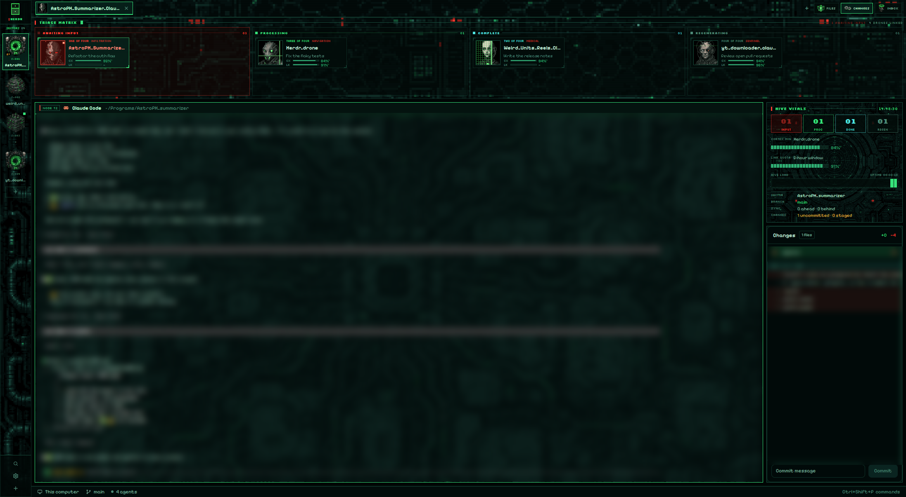

# Unimatrix

An agents-first triage deck for the [Herdr](https://herdr.dev) desktop app, in teal-black pixel art. Every agent is a drone with an animated pixel-art face, sorted into four lanes across the top of the window: AWAITING INPUT, PROCESSING, COMPLETE and REGENERATING. The drone that needs you is always the first thing you see. A thin sector rail on the left holds your spaces, and a HIVE VITALS panel on the right shows drone counts, the lowest context left, your 5-hour quota, an activity trace and the current branch.



Unimatrix grows out of [herdr-collective](https://github.com/rbkuhn/herdr-collective), which is built on [herdr-traveler](https://github.com/franky5440-afk/herdr-traveler). Its art, sounds and styling are original.

## Install

```sh
git clone https://github.com/rbkuhn/herdr-unimatrix
cd herdr-unimatrix
H=~/.config/herdr-app
cp layouts/unimatrix.json layouts/unimatrix.png "$H/layouts/"
cp themes/unimatrix.json "$H/themes/"
cp -r mods/unimatrix-rail mods/unimatrix-board mods/unimatrix-tabs mods/unimatrix-vitals mods/unimatrix-pane "$H/mods/"
herdr-app do layout.switch '{"name":"unimatrix"}'
```

Press `ctrl-shift-l` to switch back. To remove Unimatrix, delete the files you copied.

Before installing, note that two mods run `git` locally:

- `unimatrix-rail` runs `git status` in each space's folder, at most every 20 s, while the window is in front.
- `unimatrix-vitals` runs it in the shown space's folder every 10 s.

No mod reaches the network.

### Optional: fill CORTEX and LINK (Claude Code)

The drone cards and vitals read a small cache file that a Claude Code statusline writes:

```sh
mkdir -p ~/.config/herdr-app/scripts
cp scripts/unimatrix-statusline.sh scripts/unimatrix-record.mjs ~/.config/herdr-app/scripts/
```

Then set Claude Code's statusline in `~/.claude/settings.json`:

```json
"statusLine": { "type": "command", "command": "/bin/sh ~/.config/herdr-app/scripts/unimatrix-statusline.sh" }
```

The script needs `node` and prints nothing, so your statusline stays empty. If you already have a statusline, add a line to `unimatrix-statusline.sh` that pipes `$input` into it. The statuslines from herdr-collective, herdr-inferno and herdr-traveler write the same cache, so if you use one of them already, skip this step. Without any of them, the bars show "—".

### Optional: sounds

A six-voice hive chorus says "Assimilation complete." when an agent finishes and "Drone requires input." when one needs you. Add this to `~/.config/herdr-app/settings.json`. This setting applies to every layout:

```json
"sounds": {
  "enabled": true,
  "done": "mods/unimatrix-rail/sounds/done_voice.mp3",
  "blocked": "mods/unimatrix-rail/sounds/blocked_voice.mp3"
}
```

Other takes are included:

- `done.mp3` and `blocked.mp3` add a choir chord and a red-alert tone under the voices.
- The `_fx_only` files have the effects with no voices.

Clicking a drone always plays `blip.mp3`.

## Customise

- **Which drone a tab gets:** edit `mods/unimatrix-board/jobs.json`. It maps tab names to roles: tactical, medical, engineer, scout, analyst, navigator, infiltrator or sentinel. Tabs not listed get a fixed role based on their name.
- **Which location a space gets:** edit `mods/unimatrix-rail/places.json`, e.g. `{"my-space": "vortex"}`. The choices are cube, sphere, alcove, planet, nexus and vortex.
- **Board height:** drag the line under the board. It can be 110–420px.

## Credits and licences

- Code: Apache-2.0 (see `LICENSE` and `NOTICE`). It is adapted from Herdr's shipped mods and from herdr-traveler, both Apache-2.0.
- Art: the drone faces, locations, icons and backgrounds were generated with OpenAI image models for this project. They were reduced by script to fixed pixel palettes and animated frame by frame. They are released under Apache-2.0.
- Sounds: generated with ElevenLabs on a paid plan, processed with ffmpeg, and released under Apache-2.0.
- Fonts: [Silkscreen](https://fonts.google.com/specimen/Silkscreen), [Pixelify Sans](https://fonts.google.com/specimen/Pixelify+Sans) and [VT323](https://fonts.google.com/specimen/VT323), SIL Open Font License 1.1 (see `mods/unimatrix-rail/fonts/OFL-*.txt`).

Unimatrix is an original work. It is not affiliated with or endorsed by any film, TV or game studio.
