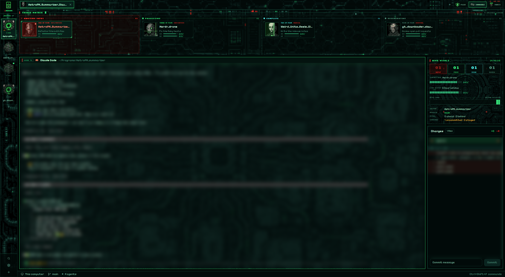

# Unimatrix

An agents-first triage deck for Herdr, in teal-black pixel art. Across the top of the window, a TRIAGE MATRIX sorts every agent into four lanes: AWAITING INPUT (red), PROCESSING (green), COMPLETE (cyan) and REGENERATING (dim). Each agent is a drone card with an animated 60px pixel-art face. A 76px sector rail on the left shows each space as a pixel location icon with a status lamp. A right column holds HIVE VITALS above the Changes/Files/Inbox panels. Terminals sit over a teal circuit hull at 50% opacity.

## What you see

Left to right, top to bottom:

- **Sector rail**: 76px, fixed. Background: `mods/unimatrix-rail/art/rail.png` (cover), with a 1px `#0d2a22` border.
  - At the top, a 34px rotating pixel cube and "HERDR", then "SECTORS 0N".
  - **Sector icons**: one per space, a 50px location icon (cube, sphere, alcove, planet, nexus or vortex), dimmed to 72% unless active.
    - Under it: "S-00N" in Silkscreen 6px and the name, truncated to 62px, at 9.5px.
    - An 8px status lamp sits on the top-right corner, coloured by the most urgent agent in the space: blocked `#ff3b30` (pulsing), working `#36e27a`, done `#4fe3e0`. Idle spaces have no lamp.
    - An amber `#e8b13a` "±N" badge on the bottom-left shows the number of uncommitted files.
    - The active sector is `#06201aee` with a 1px `#36e27a` border.
    - The tooltip gives the name, branch, ahead/behind and changes.
    - Spaces are grouped by machine under a tiny machine label.
  - **Rail foot**: + (new space), then search, settings and add machine, each with a tooltip.
- **Tab strip**: 42px over `art/strip.png`, draggable.
  - Tabs are 32px tall, with a 26px drone face and the name at 12px. The face has a red border when its agent is blocked.
  - The active tab is `#062019f2` with a 1px `#36e27a` border, `#c2ffd9` text and a 2px green underline. Other tabs are `#020c0ad8` with a `#0d2a22` border.
  - Then a + menu, FILES / CHANGES / INBOX buttons (26px, pixel icons, Silkscreen 7.5px) and window buttons.
- **Triage board**: 196px over `art/board.png`. It is resizable from 110px to 420px.
  - **Header**: "TRIAGE MATRIX" in Silkscreen 700 9px `#36e27a` and a rule. When any drone is blocked, a blinking red "N AWAITING INPUT" appears. Then "N DRONES LINKED".
  - **Lanes**: each has a label and a two-digit count in its colour. A lane with drones grows by how many it holds, with a 240px minimum. An empty lane shrinks to 64px, with its short label (INPUT, PROC, DONE, REGEN) and a faint "CLEAR". The blocked lane has a red tint and a pulsing frame.
  - **Drone cards**:
    - a 60px face in a black box with a border in the lane colour
    - the designation ("TWO OF FOUR") in the lane colour and the role in red, both Silkscreen 6.5px
    - the tab name at 12.5px 700, then the session name at 9.5px dim
    - CX and LK micro bars: 64×4px, amber under 30%, red under 15%. Stale values get a `*`; "—" means no data.
    - HUD corner brackets
- **Main**: the active tab, with 8px padding and gap. Each pane has a 28px `unimatrix-pane` header and a 1px `#174d3c` border (`#36e27a` when focused). `art/map.png` is behind the terminals at `terminal_opacity` 0.5.
  - **Pane header**: a red 3×14px tactical tick, then a "NODE T12" tag in Silkscreen 7.5px `#2fae73`, the program icon, the name and the folder. Then the status: PROCESSING with a pixel spinner, a blinking AWAITING INPUT, or COMPLETE.
- **Right column**: 330px, from 280px to 700px.
  - **HIVE VITALS** (292px, over `art/vitals.png`):
    - the title and a clock with seconds
    - four tiles, INPUT, PROC, DONE and REGEN, with big two-digit counts in each state's colour; clicking a tile focuses that lane's first drone
    - CORTEX MIN: the lowest context left among the drones, with that drone's name and a segmented LED bar
    - LINK QUOTA: the 5-hour window left
    - HIVE LOAD: a trace of how many drones were processing, one sample every 10 s for 6 minutes, with UPTIME
    - SECTOR, BRANCH, SYNC (ahead/behind) and CHANGES (uncommitted/staged) for the shown space. Amber means not in sync or dirty; green means clean.
  - Below it, a stack of Herdr's `changes`, `files` and `inbox` panels, with Changes showing first.
- **Status bar**: 26px, Herdr's `workspace-status` over `art/footer.png`.
- **Theme** `unimatrix`: background `#010a09`, foreground `#c2ead8`, accent and working `#36e27a`, blocked `#ff3b30`, done `#4fe3e0`, idle `#2f5a50`, canvas `#000504`, chrome `#020c0b`, surface `#04120f`, raised `#0a2420`, border `#174d3c99`. ANSI: `#010a09 #ff3b30 #36e27a #d9c45a #3fa8d9 #a07ae0 #4fe3e0 #c2ead8 / #2f5a50 #ff6a5e #7dffad #ecdc78 #79c8ee #c0a0f0 #8ff2ee #ecfff6`.
- **Fonts**: the UI font is Pixelify Sans. HUD labels use Silkscreen. VT323 is bundled too. All three are in `mods/unimatrix-rail/fonts/`.

## How it behaves

- **Drone faces**: each state is one horizontal strip of 192px frames, shown at 60px.
  - Frames: rest 32 at 110 ms, done 16 at 110 ms, working 24 at 75 ms, blocked 12 at 90 ms.
  - Regenerating: the drone blinks, its LEDs breathe and its implant pulses.
  - Processing: a red ocular laser or a green scan beam sweeps across the face.
  - Awaiting input: the mouth opens, the face is tinted red and glitches, and a corner lamp blinks.
  - Complete: a green assimilation grid sweeps across the face.
- **Ordering**: lanes run blocked, working, done, idle. In the blocked lane, the longest-waiting drone comes first. `setAgentOrder` follows the board order, so `agent.next` reaches blocked drones first.
- **Clicks**:
  - A drone card plays `sounds/blip.mp3` and runs `agent.focus`. So does a lane header (its first drone) or a vitals tile.
  - A sector selects its space; right-click opens the shipped `menu` mod.
  - Tabs: click selects, double-click renames, drag reorders, right-click opens a menu.
  - FILES / CHANGES / INBOX select the panel stack's child. Clicking the one already shown hides the whole right column.
- **Roles**: `mods/unimatrix-board/jobs.json` maps tab names to roles. Other tabs get a role from a hash of their name, skipping roles already used until all 8 are taken. **Locations**: `mods/unimatrix-rail/places.json`, otherwise by hash.

## Built from

- **Layout tree**: root `row`: [`sidebar` block `unimatrix-rail` (76px, min = max = 76), `work` column [`tabs` `unimatrix-tabs` 42px, `board` `unimatrix-board` 196px (110–420), `work-body` row [`main` `{tab:"active"}` with a pane frame whose header is `unimatrix-pane`, `panel` column 330px [`vitals` `unimatrix-vitals` 292px, `panel-body` stack `files`/`changes`/`inbox`, active `changes`]], `status` `workspace-status` 26px]]. Root: `theme: "unimatrix"`, `ui_font: "Pixelify Sans"`, `terminal_opacity: 0.5`, `terminal_padding: [14,12]`, `titlebar: "none"`, `preview: "layouts/unimatrix.png"`.
- **unimatrix-board**:
  - Groups `agents()` by status and calls `setAgentOrder`.
  - An 80 ms `cx.timer.every` clock calls `cx.notify()` while `window().active`, and every third tick otherwise. It skips this when there are no agents.
  - Each face is a strip image at `left(-frame * 60)` inside an `overflow_hidden` box.
  - CX and LK come from `data/traveler/sessions/<terminal>.json` (`{updatedAt, contextRemainingPct, fiveHourRemainingPct, sessionName, model, effort}`), read with `readTextFile` and `watchFolder`.
  - `lib.js` holds the roles, `designation()` and the animation table. The tabs and vitals mods have their own copies.
- **unimatrix-rail**: uses `spaces()`, `agents()`, `panes()` and `exec("git", ["status", "--porcelain=v2", "--branch"], {cwd, on})` per space, at most every 20 s while the window is active. Its cube is a 36-frame strip on a 90 ms timer. Right-click runs `openOverlay` for `menu`. It also holds every asset: art, fonts and sounds.
- **unimatrix-vitals**: a 1 s clock for the time and uptime, and a 10 s timer for the load sample and `git status` of the shown space.
- **unimatrix-tabs**: a restyled clone of collective-tabs (from Herdr's `tabs`). **unimatrix-pane**: a restyled clone of Herdr's `pane`.
- **scripts/unimatrix-statusline.sh** and **unimatrix-record.mjs**: a Claude Code statusLine that writes the session cache file atomically and prints nothing.
- **Art**: OpenAI images, BOX-downsampled and quantized to a fixed teal-only pixel palette without dithering, then upscaled with nearest-neighbour. The faces and their animation strips come from herdr-collective.
- **Sounds**: six ElevenLabs voices layered as a chorus, then processed with ffmpeg flanger, echo, a light bitcrush and band limits, and loudness-normalised. The `done`/`blocked` takes also mix in an ElevenLabs sound-effect bed.

## Watch out

- **Herdr's `image()` draws only the first frame of a GIF or animated WebP.** Step sprite strips from the mod instead.
- Herdr colours don't accept `"transparent"`. Use `#00000000`.
- The Silkscreen pixel font has no ↑/↓ glyphs. Spell out "ahead" and "behind".
- Dark background art behind a near-black theme at 50% opacity looks solid black. Keep `map.png` around 50/255 average brightness.
- When the panel stack's active button is clicked, the whole `panel` column hides, vitals included.
- Sectors can't be reordered by dragging in the rail. Use the space menu.
- The board's clock redraws the window about 12 times a second while Herdr is focused, and about 4 times a second otherwise. The vitals add one redraw a second.
- Sounds are a global Herdr setting: they play in every layout.

## Done when

- `herdr-app check` passes for all five `mods/unimatrix-*` folders, and `herdr-app status` shows `"layout": "unimatrix"` with no errors.
- A working agent's card sits in PROCESSING and its face visibly changes between screenshots taken a fraction of a second apart. A blocked agent moves to AWAITING INPUT, the lane turns red and the header blinks "1 AWAITING INPUT". Empty lanes shrink to 64px.
- With the statusline installed, CX/LK and CORTEX MIN/LINK QUOTA match Claude Code's context and 5-hour usage. Without it, they show "—".
- The rail shows a lamp on spaces with active agents and "±N" on dirty repos. Vitals show the shown space's branch and changes.
